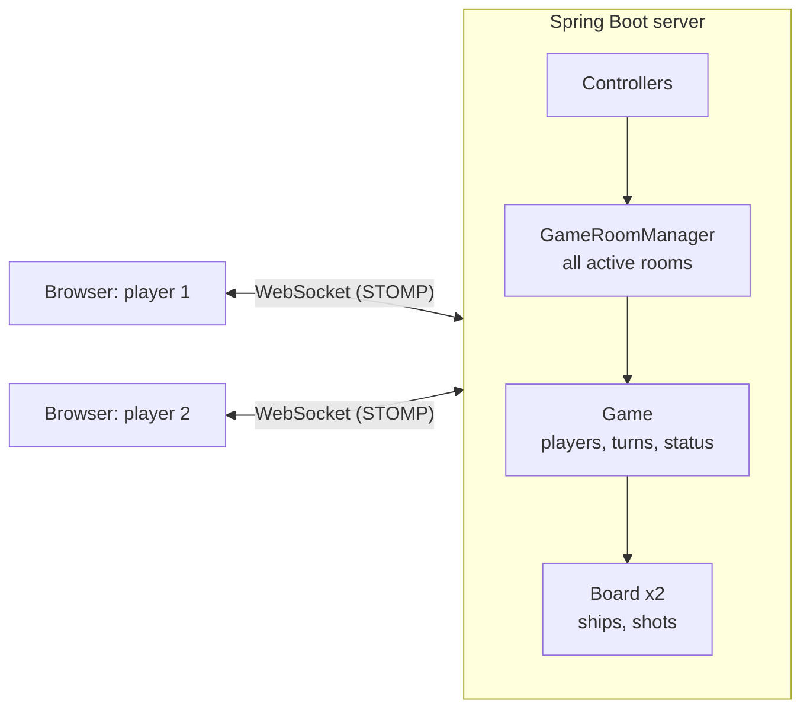
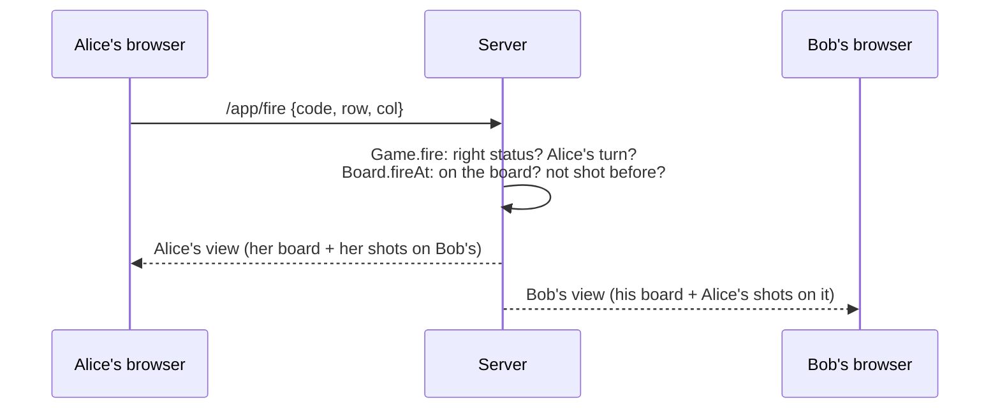

# Better Battleship (3D)

A real-time multiplayer Battleship game played in the browser, drawn in **3D with Three.js** and fought in a **thunderstorm**: a rough sea with real waves, detailed warships, lightning and thunder, driving rain, a fog bank over the enemy waters, shells, explosions and splashes. Create a room, share the 6-letter code with a friend, place your fleet, and take turns firing.

This is the 3D version of my original [Battleship](https://github.com/AdamB-Git7/Battleship). The Java server, the rules, the network protocol and the tests are the same; only the display changed.

Built in Java with Spring Boot and WebSockets, covered by 118 automated tests.

---

## Features

- **Rooms with codes**: one player creates a room, the other joins with its code (case-insensitive)
- **3D scene in a thunderstorm**: heavy moving storm clouds, wind-slanted rain, a dark sea with real waves, whitecaps and wind streaks, ships that ride the swell, a tilted aerial camera you can orbit, zoom and pan
- **Lightning and thunder**: every 6 to 15 seconds a branching bolt strikes in the distance and lights the clouds, the sea, the ships, the fog and the bridge for a few frames; the thunder arrives later, depending on the distance (a crack when close, a long rumble when far). Flashes are short and never pure white, and become one soft glow if your system asks for reduced motion
- **A reactive world**: one wind drives everything together: gusts slant the rain, raise the chop, roll the ships, bend the flames, carry the smoke and make the wind howl in the sound
- **A battle all around you**: the sea and the sky beyond the play area are never empty. Squadrons of warships steam in line to the west, to the east and far behind the fog bank, and shell each other: gun flashes that light the haze, tracers arcing across, water columns, hits, fires with tall smoke carried by the wind; a ship that has taken too much falls out of line and sinks, leaving burning oil, and a new one later arrives out of the haze. Flights of propeller planes pass beside (and sometimes high over) your fleet, dive on the distant ships and drop bombs through flak bursts and anti-aircraft tracers, and now and then one is shot down. Escorts hold station beside your zone, searchlights sweep the clouds, star shells drift down, wrecks burn on the horizon. It is pure decoration: it stays out of the two zones, the water between them and the enemy fog, it knows nothing about the game (so it cannot hint at where ships are), its flashes are soft, spaced out and toned down further with reduced motion, and it costs about 30 draw calls
- **Warships built in code**: lofted hulls (flared bow, red anti-fouling paint, waterline band), weathered paint, turrets with barrels, masts with radar, funnels, lifeboats, railings, hull numbers, a carrier with an angled flight deck and parked aircraft, a submarine with sail and dive planes
- **Sound design** (all synthesised, no audio files): rain, gusting wind and waves as a continuous ambience (muffled inside the bridge with rain drumming on the roof, open in the aerial view, with a crossfade), thunder, and heavier guns, explosions and splashes that get quieter with distance. The background battle is heard too, but kept low: the rumble of distant guns arriving after their flash, flak pops, and the drone of the planes that swells as they pass (with a Doppler shift). `SOUND ON/OFF` mutes everything
- **Ship placement** with a live 3D preview (green if valid, red if not), rotation (button, `R` or right click), and server-side checks for edges and overlaps
- **Turn-based firing**: a shell flies in an arc to the target; a hit explodes and burns (fires light the ships and the water around them), a miss throws up a column of water, a sunk ship goes down and leaves a wreck
- **Captain's bridge**: once the fleets are placed, you command in first person from the bridge of your flagship. The bridge is a dark steel room with red night lighting, instrument screens, rain running down the glass, and windows that continue into the roof: you see your own gun turrets, your fleet ahead, the storm above and the fog bank in the distance
- **Holographic tactical board**: a projector on the floor throws a miniature of the battlefield into the air (scanlines, a faint beam, glass-like ship models, interference when lightning strikes). Click one of its cells to fire: one of your ships (picked at random) sends a shell into the fog, and enemy shells come out of the fog at your fleet. `V` switches to the aerial view and back
- **Pirate guide**: Rusty, the first mate, sits in the bottom-left corner and comments on the game (wake-up intro, placement tips, hits, misses, sunk ships, victory). Click him to repeat his last line, or turn him off with the `GUIDE` button
- **Fog of war**: a dark, wind-driven fog bank covers the enemy zone and opens above each cell you shoot
- **Server-side rules**: wrong turn, repeated shots, off-board shots and moves from outside the game are all refused
- **Win detection**, then **rematch** (both players must agree) or **leave** (the opponent is told and returned to the menu; closing the tab counts as leaving)
- **Hidden boards**: a player's browser never receives the opponent's ship positions. The fog is only decoration: enemy ships are not in the 3D scene at all until the server reveals them (when sunk)

---

## How it works



Each browser keeps one WebSocket open. Players **send** moves to `/app/...` destinations, and the server **pushes** updates to each player's private `/user/queue/...` destinations.



### Design decisions

**The server is the only source of truth (anti-cheat).**
All rules live in the server's game logic, and the browser only displays what it's told. After every move, the server builds a **separate view for each player**: your own board shows your ships, but the opponent's board only shows your shots and what they hit. An opponent's ship is only revealed once it's sunk. The opponent's ship positions are never in the data sent to your browser, so there's nothing to find in the developer tools. Tests check every message of a complete networked game for leaks.

**The server decides who you are.**
Each WebSocket connection gets a random player ID during the handshake. Browsers never send their own ID, so one player can't act as the other.

**Thread safety.**
Each player is handled on their own thread, so two moves can arrive at the same moment.
- Rooms are stored in a `ConcurrentHashMap`, and new room codes use `putIfAbsent`, so two rooms can never share a code.
- Every change to a game (joining, placing, firing, rematching, leaving) is `synchronized` on that game, so a double-clicked shot can't give a player two turns. Joins to *different* rooms don't wait for each other.
- A move and the views it sends happen under the same lock, and Spring is configured to keep each player's messages in order, so a browser never shows an older board after a newer one.
- Tests start 100 threads joining one room (and 50 shots fired at once) and check that exactly one succeeds. With `synchronized` removed, those tests fail on most runs. Races depend on timing, so they don't show up every time, which is why the tests use many threads starting together.

**Full snapshots after every move.**
Each player receives their whole view, not just what changed. It keeps the browser simple (it just redraws) and self-correcting (a late message is fixed by the next one), and two 10×10 grids are tiny.

**In-memory state, no database.**
Games are short-lived, so they live in memory. The trade-off: restarting the server ends games in progress.

---

## Tech stack

| Part | Choice |
|---|---|
| Language | Java 21 |
| Framework | Spring Boot 4 (Spring Web, WebSocket + STOMP) |
| Front end | Plain HTML, CSS and JavaScript modules (no build step), [Three.js](https://threejs.org) r170 for the 3D scene, [STOMP.js](https://github.com/stomp-js/stompjs) |
| Tests | JUnit 5, including integration tests with real WebSocket clients |
| Build | Maven (wrapper included) |

---

## Testing

**118 tests**, run with `./mvnw test`:

| Kind | What they cover |
|---|---|
| **Unit tests** (93) | Ship placement and edges, shooting, sinking, turns, winning, rematch, the per-player views, and concurrency races |
| **Integration tests** (24) | The whole app started on a random port, with real WebSocket clients playing full games: joining, errors, anti-cheat checks on every message, rematch, leaving and closed tabs |

To check the tests catch real bugs, bugs were planted on purpose (an off-by-one on the board edge, a missing `synchronized`, sending the opponent's real board), and the tests were confirmed to fail before restoring the code.

---

## Running it locally

Requires **Java 21** or newer.

```bash
./mvnw spring-boot:run
```

On Windows, use `mvnw.cmd spring-boot:run`. Then open **http://localhost:8080** in two browser windows (or a normal and a private window) and play against yourself.

The browser needs WebGL (any recent Chrome, Edge, Firefox or Safari). Three.js is stored in the project (`static/vendor`), so no internet connection is needed.

**Controls**
- Placement (aerial view): left click places a ship · `R` or right click rotates it · drag with the left button to orbit, with the right button to pan · mouse wheel to zoom
- Battle (bridge view): left click on a cell of the holographic board fires · move the mouse to the top or side edges of the screen to look out of the window (up to 45° above the board, never all the way round) · `V` switches between the bridge and the aerial view (in the aerial view you fire by clicking the sea directly)

To build the runnable jar (this also runs all the tests):

```bash
./mvnw clean package
java -jar target/battleship-0.0.1-SNAPSHOT.jar
```

---

## Deployment

Not deployed yet. The `deploy/` folder holds the systemd service and scripts from the original project (AWS EC2); they need their own server address before they can be used for this version.

---

## Project structure

```
src/main/java/com/adam/battleship/
├── model/        Board, Ship, ShipType, Coordinate, CellView, ShipLayout, …
├── game/         Game (rules, turns, rematch), GameRoomManager (all rooms), PlayerView
├── controller/   WebSocket message handlers, private updates, leaving, error handling
├── dto/          The messages sent between browser and server
└── config/       WebSocket/STOMP setup, player IDs at the handshake
src/main/resources/static/
├── index.html, style.css     Page and interface (HUD) styles
├── js/
│   ├── main.js               Entry point: links network, game flow, 3D world and HUD
│   ├── config.js             Grid size, ship lengths, (row, col) <-> world coordinates
│   ├── net/network.js        STOMP WebSocket client (same protocol as the 2D game)
│   ├── game/viewDiff.js      Finds the new shot between two server views
│   ├── game/guide.js         The pirate guide's lines and when he says them
│   ├── scene/                world (builds everything, render loop), camera, grid, fleet, fog, effects, textures,
│   │                         storm (sky dome, lightning, rain, light), weather (wind and flash shared by all),
│   │                         sea (wave formula in GLSL and JS, sea shader), shipModels (ships generated in code),
│   │                         bridge (flagship and bridge interior), holoBoard (holographic tactical board),
│   │                         particles (the particle pool, one draw call), and the battle in the background:
│   │                         battlefield (entry point), battleFx (far-away flashes, fires, flak; keep-out box and
│   │                         flash limiter), backgroundFleet (squadrons, escorts, wrecks, searchlights, flares),
│   │                         aircraft (strike flights, patrol, bombs), distantModels (one-piece ships and planes)
│   ├── ui/                   hud.js (interface), input.js (mouse on the canvas), pirate.js (portrait and speech bubble)
│   └── audio/sound.js        Storm ambience, thunder, cannon, explosion, splash, and the distant battle (guns, flak,
│                             plane engines), synthesised with Web Audio
├── assets/textures/          waternormals.jpg (wave normal map)
└── vendor/                   three.js r170 (+ OrbitControls), stomp.js
src/test/java/...            unit and integration tests
deploy/                      systemd service, server setup and deploy scripts
```

---

## How I used AI

I built this with [Claude Code](https://claude.com/claude-code) as a development tool, with clear rules:

- **I wrote the core game logic** myself: the board, ships, shooting, turns, win detection, rooms, rematch, and the per-player views that hide the opponent's ships.
- **AI helped with** project setup, the WebSocket controllers, the front end and its visuals, deployment scripts, writing tests, and reviewing my code.
- **The 3D front end** of this version (the Three.js scene, effects and interface) was built with Claude Code from my specification, on top of the unchanged server.
- **Every AI change was tested**, and tests were checked by deliberately breaking the code. That process caught real problems, including a race condition in an early design and gaps in AI-written tests, which were then fixed.

---

## What I'd add next

- A big map and special powers (for example a rocket that hits several cells)
- Real glTF ship models and recorded sound effects (today both are generated in code)
- HTTPS with a domain name
- Continuous deployment from GitHub Actions on every push
- Reconnecting to your game after a page refresh
- An AI opponent (hunt-and-target) for single-player games
- Shared game state (for example Redis) so a deploy doesn't end games, and several servers behind a load balancer

---

## Credits

- [Three.js](https://github.com/mrdoob/three.js) (MIT licence), including its `OrbitControls` example and the `waternormals.jpg` texture. Everything else in the scene (sky, sea, ships, textures, sounds) is generated in code
- [STOMP.js](https://github.com/stomp-js/stompjs) (Apache 2.0 licence)

---

Made by [Adam Benikhlef](https://github.com/AdamB-Git7).
