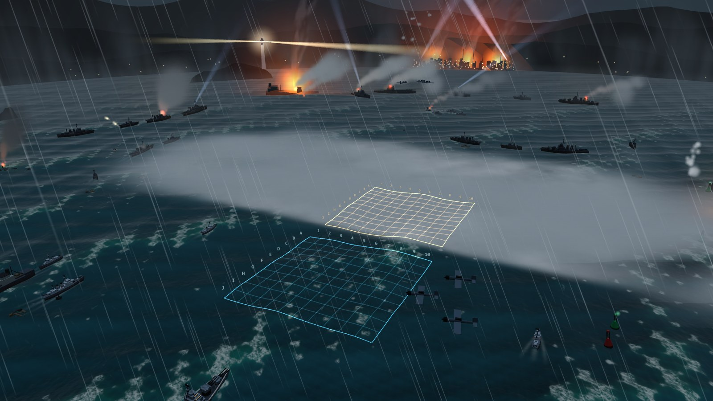
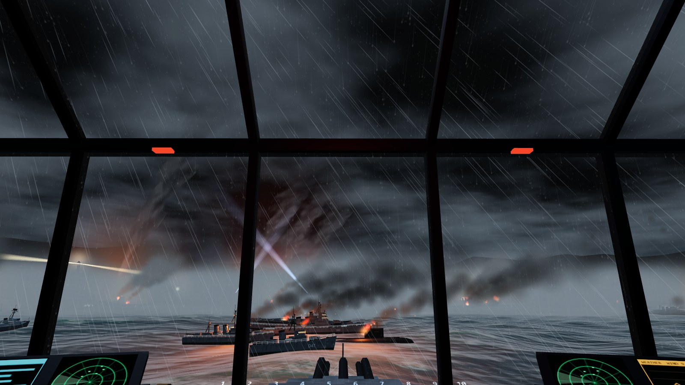
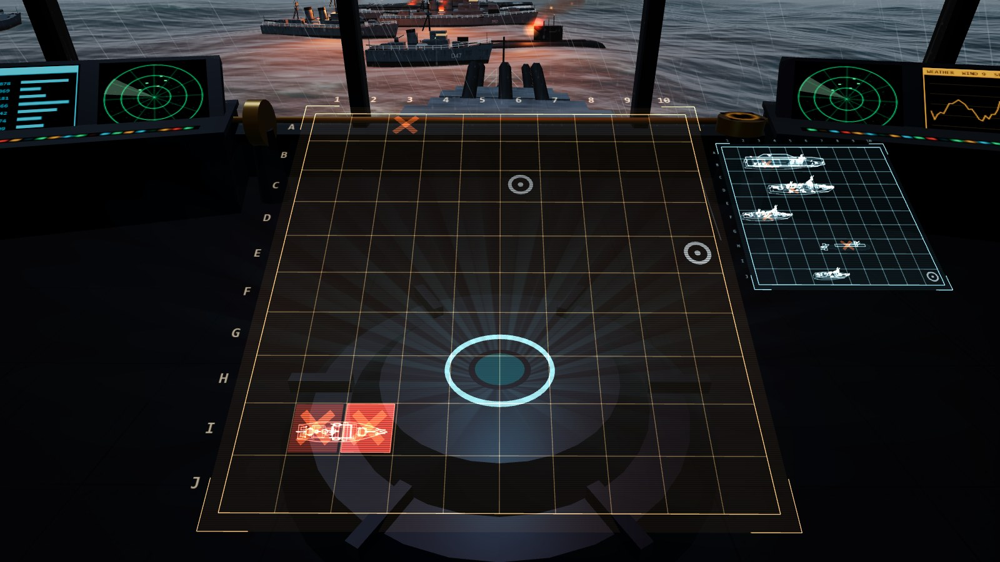
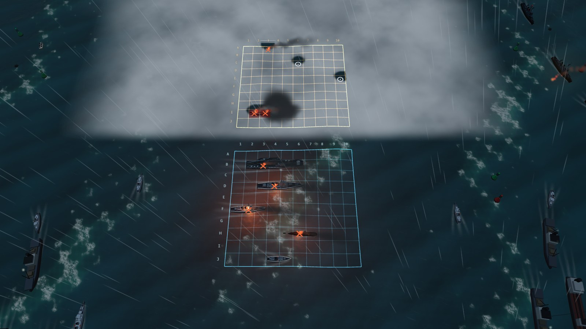
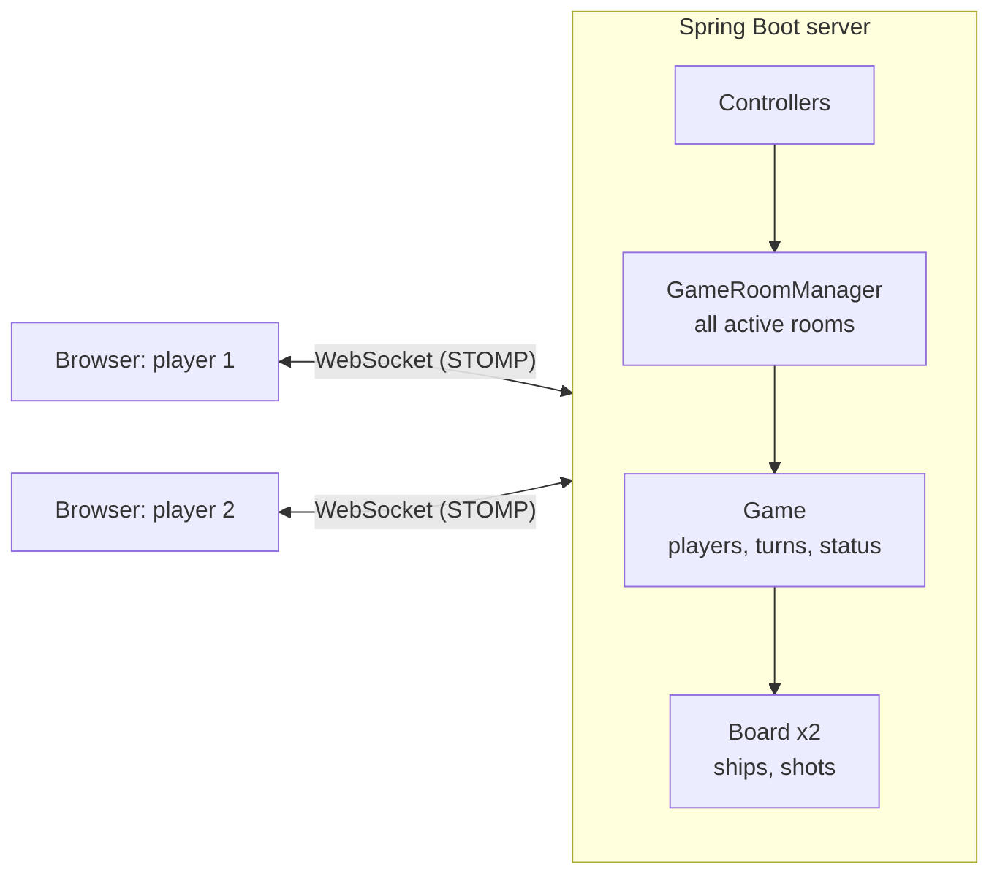
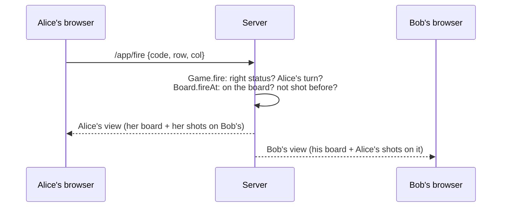

# Better Battleship (3D)

A real-time multiplayer Battleship game played in the browser, rebuilt in **3D with Three.js** and fought at night in a **thunderstorm**, in the middle of a huge naval battle. Create a room, share the 6-letter code with a friend, place your fleet from the air, then command the fight in first person from your captain's bridge.



This is the 3D version of my original [Battleship](https://github.com/AdamB-Git7/Battleship). The Java server, the rules, the network protocol and the 118 automated tests are the same; the browser side was rebuilt from scratch.

| From the bridge | Aiming on the holographic board |
|---|---|
|  |  |

---

## How a game goes

1. **Create or join a room.** One player creates a room and shares the code; the other joins with it.
2. **Place your fleet from the air.** A 3D preview of each ship follows the mouse (green if it fits, red if not). `R` or right click rotates it. The server checks edges and overlaps again.
3. **Take command on the bridge.** When both fleets are ready, the camera flies into the bridge of your flagship. A holographic miniature of the battlefield floats in front of you: the enemy zone is big on your turn, your own zone on theirs.
4. **Fire.** Click a cell of the holographic board. One of your ships sends a shell into the fog; enemy shells come out of the fog at your fleet. Hits explode and burn, misses throw up a column of water.
5. **Sink them all.** A ship whose last cell is hit goes down in a sinking sequence. The first to sink the whole enemy fleet wins, then both players can agree to a rematch.

`V` switches between the bridge and the aerial view at any time (in the aerial view you fire by clicking the sea).



---

## Features

### Gameplay
- **Rooms with codes** (case-insensitive), **turn-based firing**, **win detection**, **rematch** (both players must agree) and **leave** (the opponent is told; closing the tab counts as leaving)
- **Server-side rules**: wrong turn, repeated shots, off-board shots and moves from outside the game are all refused
- **Hidden boards (anti-cheat)**: a browser never receives the opponent's ship positions. The fog is only decoration: enemy ships are not in the 3D scene at all until the server reveals them, when they are sunk
- **Pirate guide**: Rusty, the first mate, sits in the corner and comments on the game (intro, placement, hits, misses, sunk ships, victory). Click him to repeat his last line; the `GUIDE` button turns him off

### The captain's bridge
- A dark steel bridge with red night lighting, radar and instrument screens, rain running down the glass, and windows that continue into the roof
- **Look around** by moving the mouse to the edges of the screen: up to 45° above the board to watch the battle, and left or right, never all the way round. In the middle of the screen, where the board is, nothing moves, so aiming is never disturbed
- **Holographic tactical board**: a floor projector throws the battlefield into the air, with scanlines, a faint light beam, glass-like ship models and interference when lightning strikes

### The storm and the sea
- Heavy storm clouds moving with the wind, slanted rain, and **lightning** every 6 to 15 seconds that lights the clouds, the sea, the ships and the bridge. Flashes are short and never pure white, and become a soft glow if the system asks for reduced motion
- A rough sea with **real waves** (computed on the GPU), whitecaps and wind streaks; ships, markers and grid lines all ride the same waves
- One shared wind: gusts slant the rain, raise the chop, roll the ships, bend the flames and carry the smoke
- A **fog bank** over the enemy zone that opens above each cell you shoot

### Ships, fire and sinking
- **Warships generated in code**: shaped hulls with red anti-fouling paint, turrets, radar masts, funnels, lifeboats, railings and hull numbers; a carrier with an angled flight deck and parked aircraft; a submarine with its sail and dive planes
- Shells fly in arcs; fires light the ships and the water around them; smoke blows downwind
- **Ships that really sink** (10 to 14 seconds, never twice the same): a magazine explosion with debris, the ship listing and settling by the bow or stern while it burns, then the plunge. The big ships stand on end and sometimes break in two, small ones may capsize, and the submarine dives. Fires hiss out as the water reaches them. Foam, bubbles, burning oil and floating wreckage are left behind, fading to an oil stain that marks the spot. The game never waits for it: the next turn starts at once

### A whole battle around you
Pure decoration, kept out of the play area, and it knows nothing about the game, so it cannot give anything away:
- **On the horizon**: a coastline with a burning harbour town, a lighthouse with turning beams, coastal guns and searchlights
- **On the sea**: squadrons of warships shelling each other (hits, fires, sinkings, replacements arriving), convoys with escorts and barrage balloons, torpedo boats racing with white wakes, buoys, mines, lifeboats and burning oil
- **In the sky**: strike flights diving on distant ships through flak, a low patrol, heavy bombers high up, flares and searchlights

### Sound
- **Real recorded rain and thunder** (CC0): the rain is muffled on the bridge (with rain drumming on the roof) and open in the aerial view. Close strikes give a crack and a roll, distant ones only a low roll that arrives after the flash
- Synthesised guns, explosions, splashes, the sinking (blasts, steel groans, steam, a bubbling rumble) and the distant battle (gunfire, flak, plane engines), all kept under the storm
- Starts quietly and fades in; `SOUND ON/OFF` mutes everything

---

## Running it locally

Requires **Java 21** or newer and a browser with WebGL (any recent Chrome, Edge, Firefox or Safari).

```bash
./mvnw spring-boot:run
```

On Windows, use `mvnw.cmd spring-boot:run`, or open the folder in IntelliJ IDEA (as a Maven project) and run `BattleshipApplication`. Then open **http://localhost:8080** in two browser windows (or a normal and a private window) and play against yourself. Click once in the page to start the sound.

Everything the game needs is in the project (Three.js, the sounds, the textures), so no internet connection is needed.

### Controls

| | Aerial view | Bridge view |
|---|---|---|
| Place a ship | Left click on your (cyan) grid | |
| Rotate the ship | `R` or right click | |
| Fire | Left click on the enemy (orange) grid | Left click on the enemy part of the holographic board |
| Camera | Drag with the left button to orbit, right button to pan, wheel to zoom | Move the mouse to the screen edges to look out of the window |
| Switch view | `V` or the view button | `V` or the view button |

To build the runnable jar (this also runs all the tests):

```bash
./mvnw clean package
java -jar target/battleship-0.0.1-SNAPSHOT.jar
```

---

## How it works



Each browser keeps one WebSocket open. Players **send** moves to `/app/...` destinations, and the server **pushes** updates to each player's private `/user/queue/...` destinations.



### Design decisions

**The server is the only source of truth (anti-cheat).**
All rules live in the server's game logic, and the browser only displays what it's told. After every move, the server builds a **separate view for each player**: your own board shows your ships, but the opponent's board only shows your shots and what they hit. An opponent's ship is only revealed once it's sunk. The opponent's ship positions are never in the data sent to your browser, so there's nothing to find in the developer tools, and the 3D scene can't leak what it never received. Tests check every message of a complete networked game for leaks.

**The server decides who you are.**
Each WebSocket connection gets a random player ID during the handshake. Browsers never send their own ID, so one player can't act as the other.

**Thread safety.**
Each player is handled on their own thread, so two moves can arrive at the same moment.
- Rooms are stored in a `ConcurrentHashMap`, and new room codes use `putIfAbsent`, so two rooms can never share a code.
- Every change to a game (joining, placing, firing, rematching, leaving) is `synchronized` on that game, so a double-clicked shot can't give a player two turns. Joins to *different* rooms don't wait for each other.
- A move and the views it sends happen under the same lock, and Spring is configured to keep each player's messages in order, so a browser never shows an older board after a newer one.
- Tests start 100 threads joining one room (and 50 shots fired at once) and check that exactly one succeeds. With `synchronized` removed, those tests fail on most runs.

**Full snapshots after every move.**
Each player receives their whole view, not just what changed. The browser stays simple and self-correcting. To animate a shot, it compares the previous view with the new one to find the cell that was just fired at (`game/viewDiff.js`), plays the shell, and only then shows the result.

**In-memory state, no database.**
Games are short-lived, so they live in memory. The trade-off: restarting the server ends games in progress.

### The 3D front end

- **No build step**: plain JavaScript modules with an import map; Three.js is vendored in `static/vendor`.
- **One scene, one render loop** (`scene/world.js`): the storm runs first each frame (it decides the wind and the lightning), then everything that reacts to it.
- **Cheap by design**: one particle pool for all fire, smoke and spray (one draw call); instanced and merged geometry for the background; no shadow maps; no per-frame allocations.
- **Sound** loads the storm recordings while the page loads and starts on the first click, as browsers require.
- **Static files are revalidated** on every load (`Cache-Control: no-cache`), so after an update the browser never mixes old and new script modules.
- **Developer hook**: open the page with `?debug` to step frames and time them from the console (`window.__bb`). It exposes nothing the browser doesn't already have.

---

## Tech stack

| Part | Choice |
|---|---|
| Language | Java 21 |
| Framework | Spring Boot 4 (Spring Web, WebSocket + STOMP) |
| Front end | HTML, CSS and JavaScript modules, [Three.js](https://threejs.org) r170, Web Audio API, [STOMP.js](https://github.com/stomp-js/stompjs) |
| Tests | JUnit 5, including integration tests with real WebSocket clients |
| Build | Maven (wrapper included) |

---

## Testing

**118 tests**, run with `./mvnw test`:

| Kind | What they cover |
|---|---|
| **Unit tests** (93) | Ship placement and edges, shooting, sinking, turns, winning, rematch, the per-player views, and concurrency races |
| **Integration tests** (24) | The whole app started on a random port, with real WebSocket clients playing full games: joining, errors, anti-cheat checks on every message, rematch, leaving and closed tabs |

To check the tests catch real bugs, bugs were planted on purpose (an off-by-one on the board edge, a missing `synchronized`, sending the opponent's real board), and the tests were confirmed to fail before restoring the code.

The 3D front end was checked by playing full games in the browser against a scripted opponent (placement, firing from the board and from the air, sinkings, victory, rematch, leaving), looking at every view, and watching the console for errors.

---

## Project structure

```
src/main/java/com/adam/battleship/
├── model/          Board, Ship, ShipType, Coordinate, CellView, ShipLayout, …
├── game/           Game (rules, turns, rematch), GameRoomManager (all rooms), PlayerView
├── controller/     WebSocket message handlers, private updates, leaving, error handling
├── dto/            The messages sent between browser and server
└── config/         WebSocket/STOMP setup, player IDs at the handshake

src/main/resources/static/
├── index.html, style.css   Page and interface (HUD)
├── js/
│   ├── main.js             Game flow: links the network, the 3D world, the HUD and the pirate
│   ├── config.js           Grid size, ship lengths, (row, col) <-> world coordinates
│   ├── net/                network.js: STOMP WebSocket client
│   ├── game/               viewDiff.js (finds the new shot), guide.js (the pirate's lines)
│   ├── ui/                 hud.js, input.js (mouse), pirate.js (portrait and speech bubble)
│   ├── audio/              sound.js: recorded storm, synthesised effects, mixing
│   └── scene/
│       ├── world.js        Builds everything and runs the render loop
│       ├── camera.js       Aerial views (orbit) and the first-person bridge
│       ├── storm.js        Sky dome, clouds, lightning, rain
│       ├── weather.js      Wind, gusts and lightning flash shared by everything
│       ├── sea.js          Wave formula (GPU and JavaScript) and the sea shader
│       ├── grid.js         The grids on the sea, markers, picking
│       ├── fog.js          The fog bank over the enemy zone
│       ├── shipModels.js   Warships generated in code
│       ├── fleet.js        The player's and revealed ships: floating, wakes, placement preview
│       ├── sinking.js      The sinking sequence and the wreck site
│       ├── effects.js      Shells, explosions, splashes, fires
│       ├── particles.js    The shared particle pool
│       ├── bridge.js       The flagship and the bridge interior
│       ├── holoBoard.js    The holographic tactical board
│       ├── textures.js     Textures drawn on canvases
│       └── battlefield.js  The background battle, with battleFx, backgroundFleet, aircraft, coast,
│                           convoy, smallCraft, flotsam, mist, billboards, wakes, beams,
│                           distantModels and propModels
├── assets/audio/           rain-loop.mp3, thunder.mp3 (real storm recordings, CC0)
├── assets/textures/        waternormals.jpg
└── vendor/                 three.js r170 (+ OrbitControls), stomp.js

src/test/java/...           Unit and integration tests
docs/                       Screenshots
deploy/                     systemd service and deploy scripts (from the original project)
```

---

## Deployment

Not deployed yet. The `deploy/` folder holds the systemd service and scripts from the original project (AWS EC2); they need their own server address before they can be used for this version.

---

## How I used AI

I built this with [Claude Code](https://claude.com/claude-code) as a development tool, with clear rules:

- **I wrote the core game logic** myself: the board, ships, shooting, turns, win detection, rooms, rematch, and the per-player views that hide the opponent's ships.
- **AI helped with** project setup, the WebSocket controllers, the front end and its visuals, deployment scripts, writing tests, and reviewing my code.
- **The 3D version** was built with Claude Code from my written specification, in steps (the 3D scene, the pirate guide, the bridge and the holographic board, then the storm, the background battle, the sinking and the sound), on top of the unchanged server.
- **Every change was tested**: the server tests on every step, and full games played in the browser for the front end. Tests were checked by deliberately breaking the code. That process caught real problems, including a race condition in an early design, gaps in AI-written tests, and in the 3D version clicks landing on the wrong cell and stale script files after an update, which were then fixed.

---

## What I'd add next

- Reconnecting to your game after a page refresh
- An AI opponent (hunt-and-target) for single-player games
- Recorded sounds for the guns and explosions, and glTF ship models
- HTTPS with a domain name, and continuous deployment from GitHub Actions
- Shared game state (for example Redis) so a deploy doesn't end games, and several servers behind a load balancer

---

## Credits

- Storm recordings (CC0, public domain) from OpenGameArt: [Rain loopable](https://opengameart.org/content/rain-loopable) (`assets/audio/rain-loop.mp3`) and [Rain (long thunder)](https://opengameart.org/content/rain-long-thunder) (the thunderclap cut into `assets/audio/thunder.mp3`)
- [Three.js](https://github.com/mrdoob/three.js) (MIT licence), including its `OrbitControls` example and the `waternormals.jpg` texture. Everything else in the scene (sky, sea, ships, the background battle, textures) is generated in code
- [STOMP.js](https://github.com/stomp-js/stompjs) (Apache 2.0 licence)

---

Made by [Adam Benikhlef](https://github.com/AdamB-Git7).
